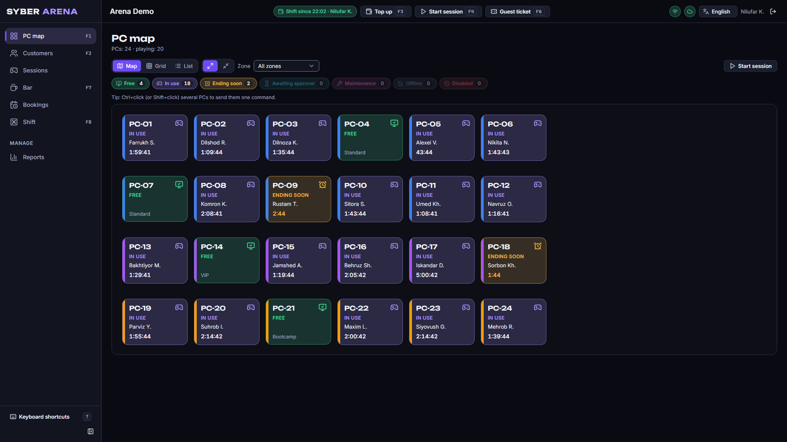
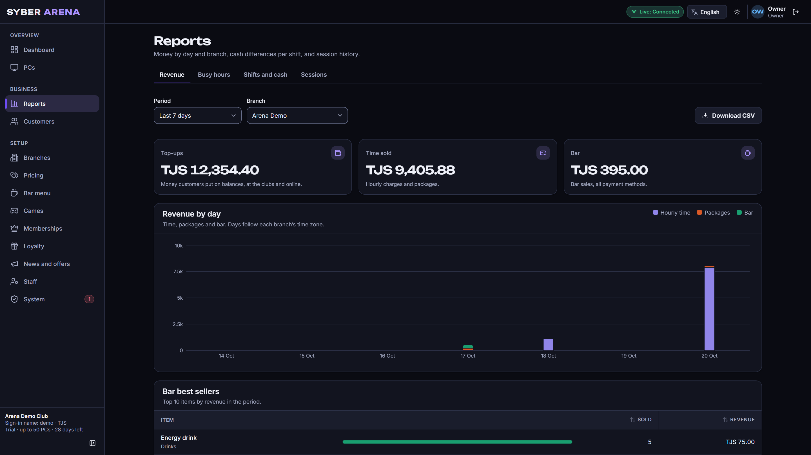
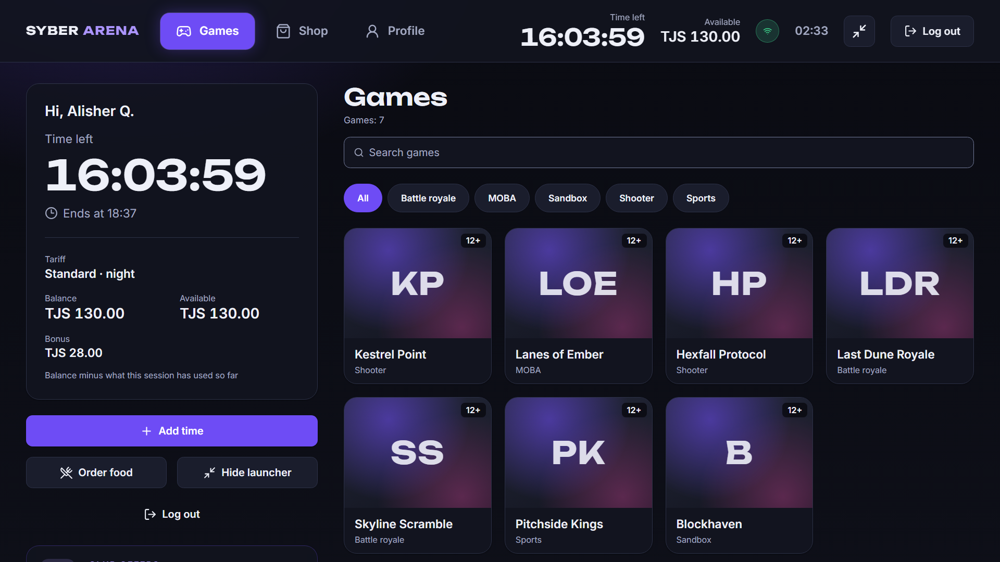
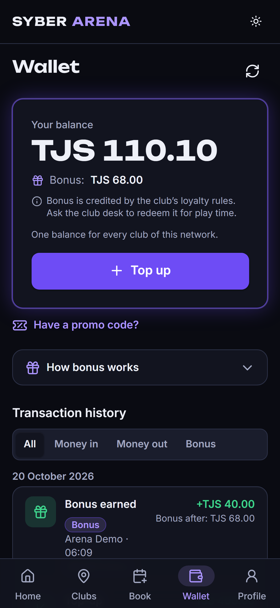
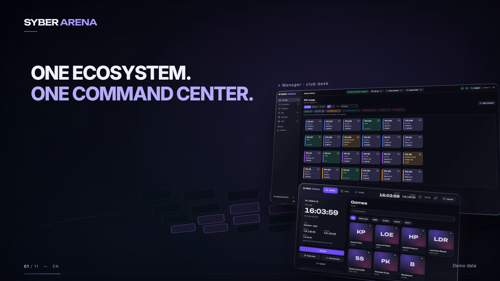
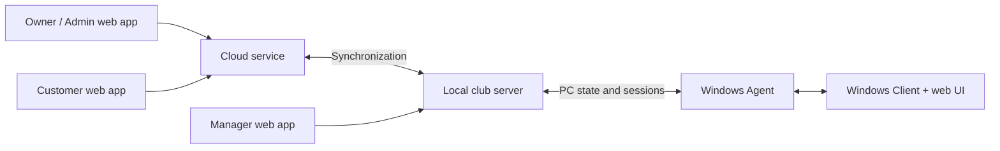

# SYBER ARENA

**A connected management ecosystem for computer clubs and gaming centers.**

SYBER ARENA brings club operations, owner administration and the player experience into one product: a cloud service, a local club server, Windows software on gaming PCs and dedicated interfaces for staff, owners and customers.

This is the public engineering showcase. The commercial implementation, deployment configuration and production history remain private.

## Product experience

*The actual Manager interface running against an isolated demonstration environment. All people, club records, balances and activity shown in this repository are synthetic demonstration data.*

| Interface | Purpose |
| --- | --- |
| Manager | PC status, sessions, desk operations and bar/POS workflows |
| Admin | Branch administration, staff and PC management, pricing and reporting |
| Customer | Club discovery, bookings and wallet information |
| Gaming-PC Client | Session information, game library and club-service interface |

View the Admin, Customer and PC Client interfaces

*Revenue report from the actual Admin application. Demonstration totals and an intentionally sparse time series are not business performance metrics.*

*The actual PC Client interface. Game titles and artwork in this capture are fictional demonstration assets.*

*The actual Customer wallet interface. A visible top-up control does not establish a live payment-provider integration.*

## Promotional film

**Nine finished editions:** download the main film, vertical cut or teaser in English, Russian or Tajik below. Final encoded-file checks and sampled local browser playback passed for every edition.

V3 presents genuine demonstration imagery through perspective camera moves, layered glass panels and animated Cloud/club-server/PC connections. An original instrumental score is joined by procedural interface ticks, panel contacts, transition effects and action-synchronized confirmations.

The motion captions are available in English, Russian and Tajik Cyrillic. Application imagery remains in English, and there is no voiceover. All shown records are synthetic; SYBER ARENA remains a pre-release product.

| Cut | Format | English | Russian | Tajik |
| --- | --- | --- | --- | --- |
| Main film | 56 s · 1920×1080 · 30 fps | [EN MP4](https://github.com/Scoronosar0K0/syber-arena-showcase/releases/download/v3.0/syber-arena-v3-main-en.mp4) | [RU MP4](https://github.com/Scoronosar0K0/syber-arena-showcase/releases/download/v3.0/syber-arena-v3-main-ru.mp4) | [TG MP4](https://github.com/Scoronosar0K0/syber-arena-showcase/releases/download/v3.0/syber-arena-v3-main-tg.mp4) |
| Vertical cut | 24 s · 1080×1920 · 30 fps | [EN MP4](https://github.com/Scoronosar0K0/syber-arena-showcase/releases/download/v3.0/syber-arena-v3-vertical-en.mp4) | [RU MP4](https://github.com/Scoronosar0K0/syber-arena-showcase/releases/download/v3.0/syber-arena-v3-vertical-ru.mp4) | [TG MP4](https://github.com/Scoronosar0K0/syber-arena-showcase/releases/download/v3.0/syber-arena-v3-vertical-tg.mp4) |
| Teaser | 12 s · 1920×1080 · 30 fps | [EN MP4](https://github.com/Scoronosar0K0/syber-arena-showcase/releases/download/v3.0/syber-arena-v3-teaser-en.mp4) | [RU MP4](https://github.com/Scoronosar0K0/syber-arena-showcase/releases/download/v3.0/syber-arena-v3-teaser-ru.mp4) | [TG MP4](https://github.com/Scoronosar0K0/syber-arena-showcase/releases/download/v3.0/syber-arena-v3-teaser-tg.mp4) |

The main and vertical cuts illustrate selected local operations during a Cloud-link interruption. A working club server and local network are required; online services still need connectivity. Reconnection demonstrates a returning link indicator, not guaranteed availability or lossless recovery. See the [demonstration asset notes](docs/demonstrations.md).

Previous V2 English edition

The earlier edit is preserved: [56 s main](assets/video/syber-arena-main-56s-web.mp4), [24 s vertical](assets/video/syber-arena-vertical-24s-web.mp4) and [12 s teaser](assets/video/syber-arena-teaser-12s-web.mp4). Its [main poster](assets/video/poster-main.png) remains available.

## Engineering overview

The cloud handles centralized product concerns; the club server owns local operational workflows. The Agent and Client bridge service-level PC controls and the player-facing interface. This is a simplified logical diagram, not a deployment or security specification.

| Layer | Technologies present in the reviewed implementation |
| --- | --- |
| Web interfaces | React 18, TypeScript, Vite, React Router, TanStack Query, Tailwind CSS |
| Services and data | C#, .NET 10, ASP.NET Core, Entity Framework Core, PostgreSQL |
| Communication | SignalR and explicit Cloud/Edge synchronization workflows |
| Windows software | Windows services, WPF, WebView2 and local IPC |
| Verification | .NET test projects, Vitest, Playwright and Windows-specific test procedures |

## What is implemented

Source inspection confirms sessions and billing, customer wallets and bookings, local desk/cash and POS workflows, owner reports, PC status/session controls and Cloud/Edge synchronization code. Authentic demonstration captures show selected interface workflows.

The architecture supports selected local club operations during a cloud interruption. The promotional film includes footage from an isolated cloud-link interruption test (link indicator amber, a cash top-up at the desk, then the indicator back to connected). This is not a guarantee that every feature remains available offline or that recovery is lossless in every failure mode.

## Important engineering decisions

- **Separate cloud and club responsibilities.** Local operational state reduces dependence on continuous cloud access, while introducing reconciliation and recovery work.
- **Separate role-focused interfaces.** Staff, owners and customers have different tasks and information needs; the Windows client adds a device-specific experience.
- **Reuse a web interface within Windows software.** WebView2 allows a consistent UI approach while the Agent and desktop shell handle operating-system responsibilities.
- **Verify across boundaries.** Domain tests, database integration, browser flows and real Windows checks address different risks; a browser-only demonstration cannot prove device enforcement.

Read the [architecture notes](docs/architecture.md), [engineering case study](docs/engineering.md), [verification scope](docs/verification.md) and [demonstration asset notes](docs/demonstrations.md).

## Status and my contribution

SYBER ARENA is **pre-release software under active development**. Interface breadth and implementation scale do not imply commercial readiness, independently audited security, a completed real-club pilot or proven reliability metrics. Operational and recovery validation remains ongoing.

I develop SYBER ARENA as a commercial software project, using an AI-assisted workflow with Codex, Claude Code and locally hosted LLMs. This portfolio presents the resulting product and engineering work without claiming that I manually wrote every component. My work spans product requirements, application development, integration and evaluation of generated changes.

## Intellectual property

The original software is proprietary. This showcase contains selected documentation, demonstration images and promotional videos; it does not include the application source, deployable services or production binaries. Public availability does not grant rights to the underlying commercial product. See the [proprietary notice](NOTICE.md).
