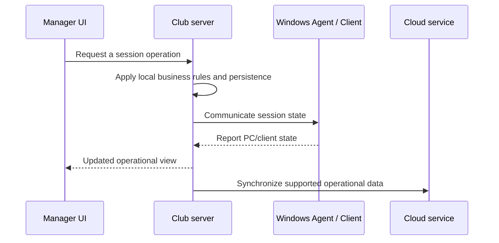

# Architecture

SYBER ARENA divides responsibilities between a centralized service and a server within each gaming club.

| Component | Main responsibility | Design consideration |
| --- | --- | --- |
| Cloud | Centralized ownership, customer and multi-club concerns | Central data and local operations must reconcile explicitly |
| Local club server | Sessions, billing and staff operations close to gaming PCs | Connectivity loss and later recovery require separate validation |
| Windows Agent | PC state and operating-system integration | Real Windows behavior needs device-level testing |
| Windows Client | Player-facing desktop shell and web UI | UI state and controlled sessions cross process boundaries |
| Manager | Staff workflows | Fast task completion and clear operational state |
| Admin | Owner workflows and reporting | Consistent business definitions and branch context |
| Customer | Player account, wallet and booking experience | Clear state across club and cloud contexts |

This sequence illustrates responsibility boundaries. It omits proprietary protocol details, authentication mechanisms, database schemas, infrastructure addresses and error-handling implementation. It does not promise successful synchronization during every network or restore scenario.

The principal trade-off is local availability versus distributed consistency. A functioning local workflow and a successful normal reconnect are useful evidence, but recovery from restored databases, interrupted writes and competing updates requires its own testing.
